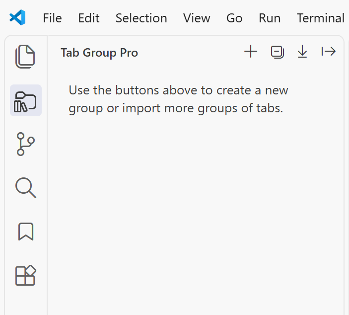
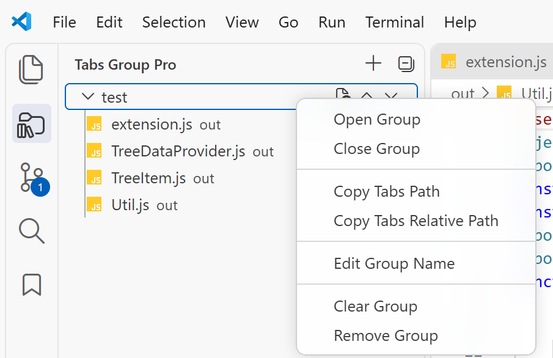

# Tabs Group Pro

简体中文 | [English](README.md)

为每个 VS Code 工作区创建可持久保存的文件分组，并按确定的顺序重新打开所需文件。

[从 Visual Studio Marketplace 安装 Tabs Group Pro](https://marketplace.visualstudio.com/items?itemName=shelus2021.tabs-group-pro)

## 功能

- 创建、重命名、排序、清空和删除文件分组。
- 拖动分组进行排序，在组内或跨组拖动标签；也可将编辑器标签拖入分组，或将分组和标签拖到编辑器打开。将分组拖到编辑器会按保存顺序打开其中尚未打开的标签，并跳过已存在标签；同时保留上移、下移操作作为备用方式。
- 将当前文件或全部已打开的文本标签添加到分组。
- 按保存顺序打开或关闭分组中的全部文件。
- 按工作区保存分组数据及展开、折叠状态。
- 使用工作区相对路径持久化分组标签，使导出的分组可随项目目录迁移。
- 从视图顶部工具栏以 JSON 导入或导出一个或多个分组。
- 单击预览文件，通过 **Open Tab** 或双击固定文件。
- 显示文件主题图标、文件名、相对目录、完整路径提示和分组文件数量。
- 复制分组中全部文件的绝对路径或工作区相对路径。
- 在已展开的分组中跟随当前活动编辑器。
- 添加文件时自动排除会造成重复的文件和分组。

## 功能预览

| 创建第一个分组 | 管理分组文件 |
| --- | --- |
|  |  |

## 快速开始

1. 在 VS Code 中打开文件夹或工作区。
2. 从活动栏打开 **Tabs Group Pro**。
3. 执行 **Tabs Group Pro: Add a New Group**，或使用 **Add All Opened Tabs to Group**。
4. 拖动分组或标签进行排序；将标签拖到其他分组即可跨组移动，也可在编辑器与分组之间双向拖动标签。

分组保存在 VS Code 的工作区状态中，再次打开同一工作区时会自动恢复。分组标签仅持久化工作区相对路径，加载时根据当前工作区重新解析。

使用视图标题栏中的 **Import Groups from JSON** 和 **Export Groups to JSON** 按钮。导出时可以逐个勾选分组，也可以一键全选；导入会先完整校验文件，在任何标签路径不匹配时不导入任何分组。

JSON 格式如下：

```json
{
  "groups": [
    {
      "name": "前端",
      "tabs": [
        "src/app.js",
        "src/styles.css"
      ]
    }
  ]
}
```

## 配置

| 配置项 | 默认值 | 说明 |
| --- | --- | --- |
| `tabs-group-pro.closeTabsOnOpenGroup` | `false` | 打开分组前关闭当前所有编辑器标签。 |
| `tabs-group-pro.closeTabsOnAddAllToGroup` | `false` | 将全部文本标签加入分组后关闭这些标签。 |

## 使用限制

- 文件必须属于当前打开的 VS Code 工作区。
- **Add All Opened Tabs to Group** 只会添加文本文件标签。
- 分组数据按工作区保存，本扩展不会在不同设备间同步数据。
- 导入的标签路径必须是工作区内已存在文件的相对路径。分组重名、标签重复、多根工作区匹配不唯一或文件缺失都会阻断整个导入。
- 当前目录来自已安装扩展，包含打包后的 JavaScript 运行时代码，但不包含原始 TypeScript 源码树。开始长期维护前请阅读 [PUBLISHING.zh-CN.md](PUBLISHING.zh-CN.md)。

## 更新日志

参见 [CHANGELOG.zh-CN.md](CHANGELOG.zh-CN.md)。

## 致谢

本项目基于 [bentodaniel](https://github.com/bentodaniel/vs-tab-groups) 的原始工作。发布派生版本前，应保留原作者署名并确认代码的再分发许可。

## 许可证与来源说明

shelus2021 原创的新增内容和修改部分采用 MIT 许可证。由于准备此版本时未在上游 VS Tab Groups 项目中找到许可证，源自上游的部分仍受其各自权利人的权利约束。

准确的许可范围见 [LICENSE](LICENSE) 和 [NOTICE.zh-CN.md](NOTICE.zh-CN.md)。如认为本项目侵犯了你的权利，请联系 [shelus2021@foxmail.com](mailto:shelus2021@foxmail.com)。
